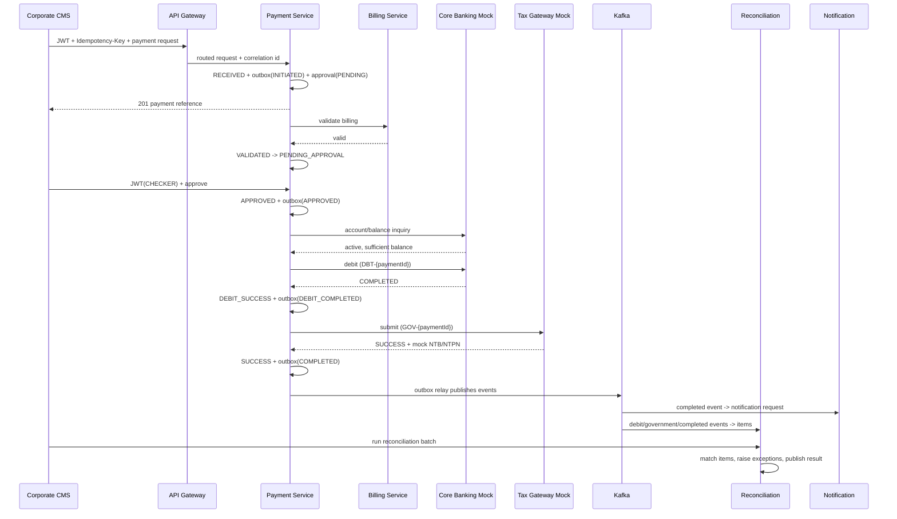

# Payment Workflow

## Implemented in Phases 1–2

1. CMS calls `POST /api/v1/tax/payments` with `Idempotency-Key`.
2. Payment Service validates the request and computes a SHA-256 hash of the canonical payload.
3. If the key exists with the same hash, the original payment is returned.
4. If the key exists with a different hash, `409 IDEMPOTENCY_CONFLICT` is returned.
5. A new payment is persisted as `RECEIVED` with a generated `TPyyyyMMddXXXXXXXXXX` reference.
6. An immutable `payment_status_histories` row is appended with actor and correlation ID.
7. The idempotency record is persisted with a 24-hour expiry.
8. A pending maker-checker approval record is created with the initiating actor as maker.
9. An audit-log row records the initiation snapshot.
10. Inquiry endpoints expose the payment, reference lookup, history and customer page.

Billing inquiry/validation is available on Billing Service and can already be used to check active status, expiry, amount, currency, taxpayer and paid status. Payment Service does not call it yet; that wiring belongs to Phase 4/5.

## Maker-checker implemented in Phase 2

- `POST /api/v1/tax/payments/{paymentId}/approve` and `/reject` require a payment in `PENDING_APPROVAL`.
- `X-Actor` is the checker; `X-Role: CHECKER` is enforced when supplied.
- Maker and checker must differ; self-approval returns `403 FORBIDDEN`.
- Approval moves the payment to `APPROVED`; rejection moves it to `FAILED`.
- The approval record stores maker, checker, decision, notes and decision time.
- History and audit rows are written in the same transaction.
- Concurrent decisions are rejected by optimistic locking with `409 CONCURRENT_MODIFICATION`.

## Target saga (Phases 4–5)

```
RECEIVED
  → VALIDATING              validate request + billing via Billing Service
  → VALIDATED
  → PENDING_APPROVAL        maker submits, checker approves
  → APPROVED
  → DEBIT_PENDING           account inquiry + debit request to Core Banking
  → DEBIT_SUCCESS           debit reference persisted; never retried blindly
  → GOVERNMENT_SUBMISSION_PENDING
  → GOVERNMENT_PROCESSING   submit to Tax Gateway; response may be delayed/lost
  → SUCCESS                 mock NTB/NTPN stored; TAX_PAYMENT_COMPLETED
```

Failure and uncertainty:

- Validation failure → `FAILED` before any debit.
- Debit timeout/unknown → `UNKNOWN`, then transaction inquiry. Do not re-debit.
- Government rejected after successful debit → `FAILED`, then `REVERSAL_PENDING` → `REVERSED` only when the debit is confirmed and the government status permits reversal.
- Government succeeded but response lost → inquiry resolves to `SUCCESS`; never reverse.
- Expired approval window → `EXPIRED`.

## State machine rules

The complete transition table lives in `id.co.taxpay.payment.domain.service.PaymentStateMachine`.

- Terminal states: `REVERSED`, `EXPIRED`.
- `SUCCESS` may move to `REVERSAL_PENDING`.
- `FAILED` may move to `REVERSAL_PENDING` only when a debit occurred.
- `UNKNOWN` can only be resolved by inquiry outcomes.
- Any attempt to skip steps (for example `RECEIVED → SUCCESS`) throws `InvalidStateTransitionException`.

## Idempotency

- Database: `payment_idempotency(idempotency_key UNIQUE, request_hash, payment_id, expires_at)`.
- Redis may cache idempotent responses later for latency, but PostgreSQL remains authoritative.
- Concurrent same-key requests are arbitrated by the unique constraint: the losing transaction rolls back and resolves the winner's payment.
- Verified with 10 parallel identical requests: one payment row, one idempotency row, identical response.
- Expired records (24h) are removed and recreated.

JWT/RBAC enforcement is completed in Phase 7; the domain-level maker-checker rules are already active.

## Sequence diagram



Failure path: if the government rejects after a successful debit, the saga moves `FAILED → REVERSAL_PENDING → REVERSED` by calling core-banking reversal. If an external result is unknown (timeout), the saga queries the transaction by deterministic reference before any retry or reversal.
